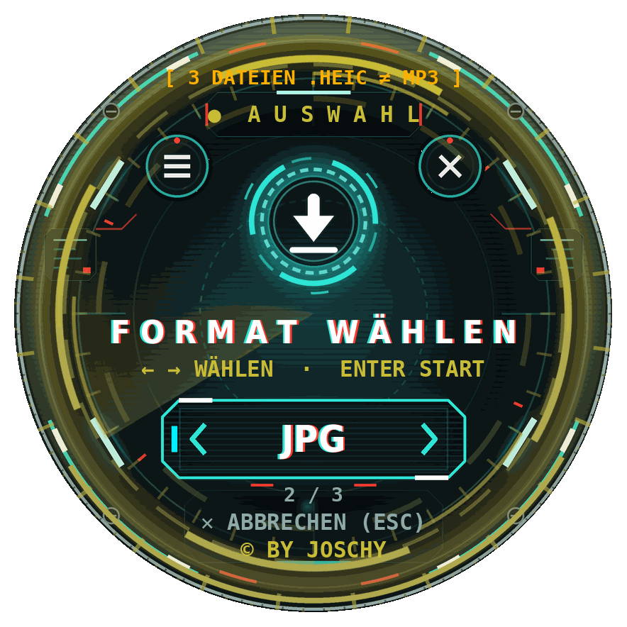

# Kreis-Konverter

Der Kreis-Konverter ist ein runder, futuristischer Datei-Konverter für Windows im HUD-Design:
Dateien einfach auf den Kreis ziehen, fertig. Er wandelt Bilder, Office-Dokumente, PDFs, Daten,
E-Books, Archive, Audio und Video um und erzeugt QR-Codes. Formate wählt man in Gruppen mit den Pfeilen;
passt eine Datei nicht, zeigt der Kreis „FORMAT WÄHLEN“ und bietet nur die möglichen Formate an.
Auf Wunsch sagt die JAI-Stimme kurze Meldungen an, die Effekte lassen sich auf voll, sparsam oder aus stellen.
Alles läuft auf dem eigenen PC, es wird nichts ins Internet geschickt. Die fertige
`KreisKonverter.exe` ist eine einzelne Datei, auf dem Zielrechner muss nichts installiert werden.
Lizenz: AGPL-3.0.

## Was das Programm kann

| Bereich | Formate / Aktionen |
|---------|--------------------|
| Bild    | PNG, JPG, WEBP, BMP, GIF, TIFF, ICO, SVG, HEIC, verkleinern (50 %, 1920/1280/800 px) |
| Office  | DOCX, XLSX, PPTX |
| PDF     | erstellen, komprimieren, teilen, zusammenführen, PDF zu Bild, Texterkennung (OCR über Windows) |
| Daten   | CSV, JSON, XML, TXT, MD |
| E-Book  | EPUB |
| Archiv  | ZIP und 7Z erstellen, ZIP/7Z/RAR entpacken |
| QR      | QR-Code aus Text oder Internetadresse |
| Audio   | MP3, WAV, FLAC, OGG, AAC, M4A |
| Video   | MP4, MKV, WEBM, AVI, MOV |

Passt eine Datei nicht zum eingestellten Format, zeigt der Kreis „FORMAT WÄHLEN“ und bietet nur die
passenden Formate an. Bedienung mit Maus und Tastatur: siehe [LIESMICH.txt](LIESMICH.txt).
Die Liste aller Formate (Taste `F`) lässt sich mit Mausrad oder Touchpad blättern und mit ↑/↓ und
Enter bedienen.

## Effekte

Im Menü unter „Effekte“ gibt es drei Stufen: **voll** (Standard), **sparsam** und **aus**.
Zeichnet der PC zu langsam, stuft das Programm die Effekte für die laufende Sitzung automatisch herab;
der Mini-Kreis zeichnet höchstens „sparsam“. Im Leerlauf zeichnet der Kreis nur 12 Bilder pro Sekunde
und bleibt nach 20 Sekunden ohne Eingabe als Standbild stehen – so braucht er kaum Rechenzeit.
Fährt die Maus über den Kreis oder wird geklickt, läuft er sofort weiter. Die Einstellung wird in
`einstellungen.json` gespeichert.

## JAI-Stimme

Optional sagt der Sprachassistent JAI kurze Meldungen an („Datei erkannt“, „Fertig“, „Bitte Format wählen“ …).
Einschalten im Menü über „JAI-Stimme“ (Standard: aus), ausprobieren mit „JAI testen“. Die Einstellung wird
in `einstellungen.json` gespeichert. Die Wiedergabe nutzt Windows selbst, es ist kein Zusatzpaket nötig.

Der Schalter „Ausführliche Ansagen“ (Standard: aus) ergänzt weitere Ansagen: gewählte Gruppe bzw. Format,
Anzahl der Dateien, Ziel und Fortschritt.

Die Stimme ist eine eigene Erzeugung von Joschy mit ElevenLabs. Die Clips liegen im Ordner [`jai/`](jai/)
im Repository und stehen, sofern nicht anders vermerkt, unter derselben Lizenz AGPL-3.0 wie das Programm.
Fehlt der Ordner, läuft das Programm ganz normal, nur ohne Ansagen.

## Starten und bauen

- **Ohne exe:** `start.bat` doppelklicken (Python 3 muss installiert sein, Pakete aus `requirements.txt`).
- **exe bauen:** `build_exe.bat` doppelklicken. Voraussetzung: Python 3.11 bis 3.14 von python.org
  („Add python.exe to PATH“ anhaken) und Internet. Das Skript installiert die Pakete in festen Versionen
  (`requirements.txt`), lädt 7-Zip von den offiziellen GitHub-Releases (`hole_7zip.ps1`) und baut mit
  PyInstaller (`KreisKonverter.spec`).
  Ergebnis: `dist\KreisKonverter.exe`.

## Lizenz

© JOSCHY – Lizenz: [AGPL-3.0](LICENSE) (GNU Affero General Public License, Version 3).

Wer das Programm – verändert oder unverändert – weitergibt, muss den Empfängern den vollständigen
Quellcode unter derselben Lizenz zugänglich machen.

## Drittkomponenten

Die exe enthält Fremdsoftware, u. a. FFmpeg (GPL-3.0), 7-Zip (LGPL-2.1 + unRAR-Einschränkung),
PyMuPDF (AGPL-3.0) und pillow-heif (BSD-3-Clause, Binärdateien mit LGPL-3.0/GPL-2.0-Teilen).
Übersicht, Quellen und vollständige Lizenztexte: Ordner [`lizenzen/`](lizenzen/) – im Programm über
Menü → „Lizenzen“.
